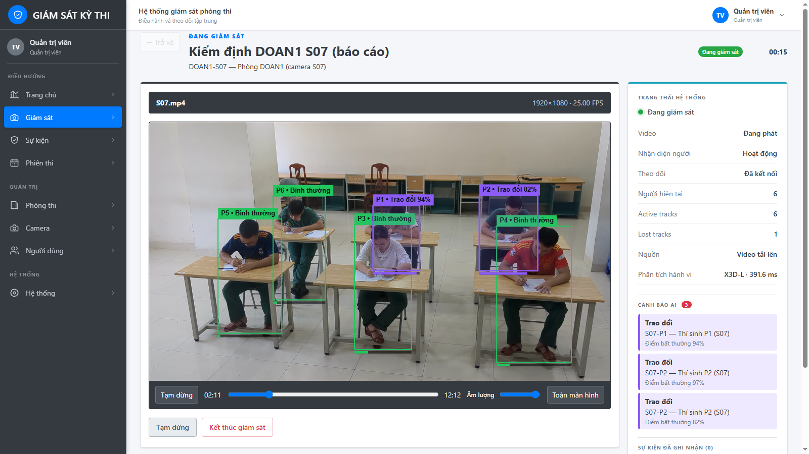
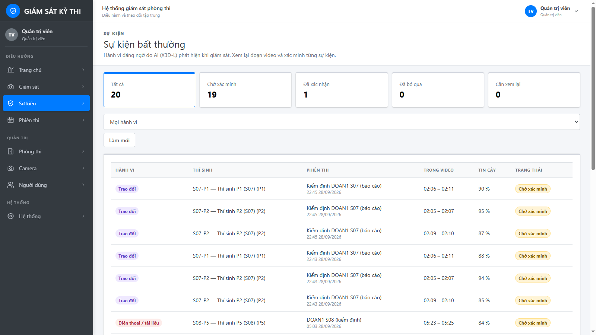
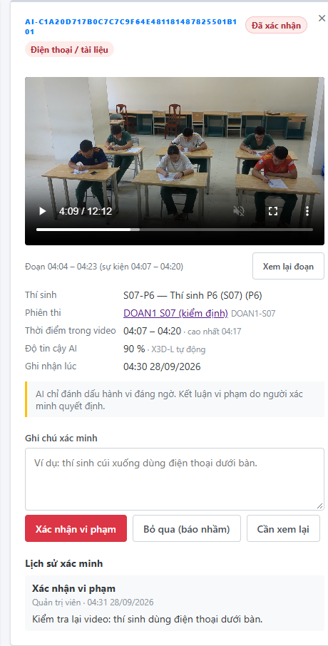
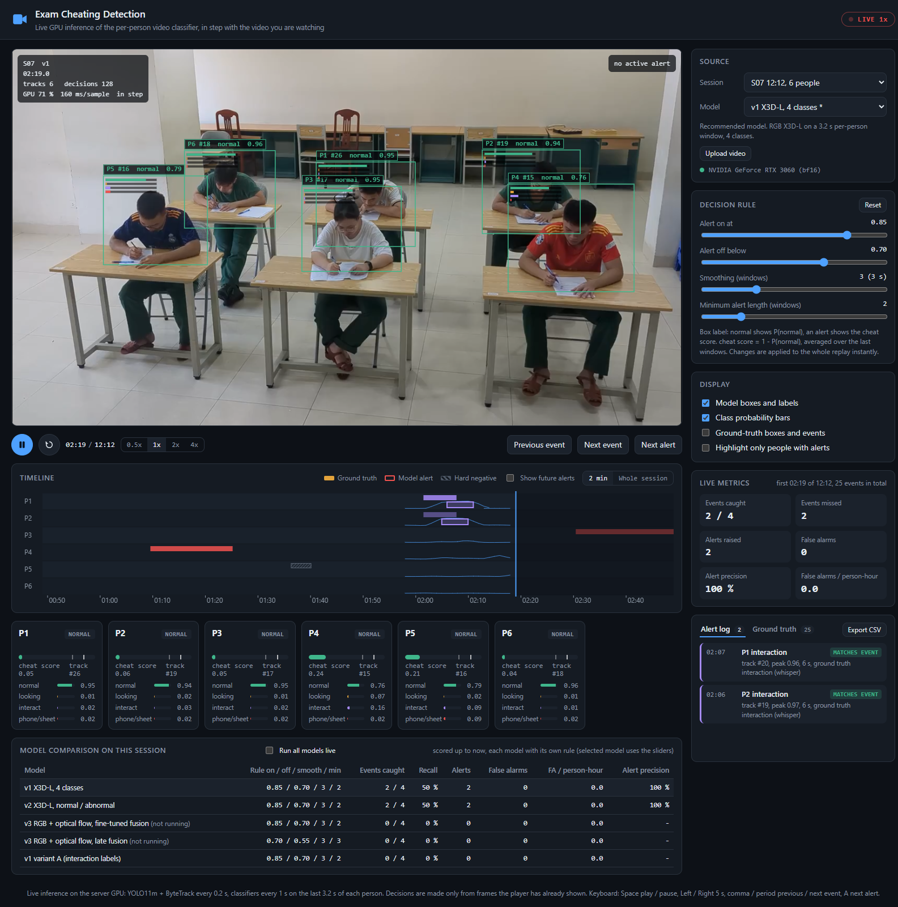
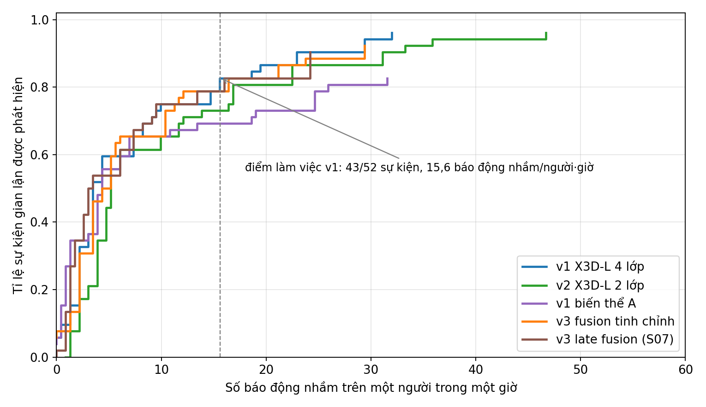

# ExamGuard: phát hiện gian lận trong phòng thi từ camera

ExamGuard theo dõi từng thí sinh qua camera phòng thi và cảnh báo theo thời gian thực khi có hành vi đáng ngờ:
**nhìn bài bạn**, **trao đổi / chuyền đồ**, **dùng điện thoại hoặc tài liệu**. Hệ thống gắn cờ đoạn video để giám thị
xem lại, không tự đưa ra kết luận thay con người.


*X3D-L gắn cờ P1 và P2 "Trao đổi" (94 %, 82 %) đúng lúc hai thí sinh thì thầm, bốn thí sinh còn lại bình thường.*

## Giao diện

**Danh sách sự kiện**: mỗi hành vi đáng ngờ kèm thí sinh, thời điểm trong video, độ tin cậy và trạng thái xác minh của giám thị.



**Xác minh sự kiện**: giám thị xem lại đoạn video, rồi xác nhận vi phạm, bỏ qua (báo nhầm) hoặc đánh dấu cần xem lại. AI chỉ đánh dấu, quyết định thuộc về con người.



**Live demo**: suy luận trên GPU đồng bộ với video, hiển thị khung và xác suất từng người, timeline cảnh báo so với nhãn thật, và so sánh các mô hình.



## Cách hoạt động

```
camera ─► YOLO11 (phát hiện người) ─► ByteTrack (gán ID từng người)
            │
            └─► mỗi giây cắt clip 3,2 s của từng người ─► X3D-L (mạng video 3D)
                                                            │
                     xác suất 4 lớp: normal / looking / interaction / phone_cheatsheet
                                                            │
                     làm mượt 3 s + ngưỡng trễ (bật 0,85 / tắt 0,70) ─► CẢNH BÁO + loại hành vi
```

## Kết quả (tập kiểm tra S07 + S08, không dùng để train)

| Mô hình | AUROC | Macro-F1 | Sự kiện bắt được trên video đầy đủ |
|---|---|---|---|
| **v1 X3D-L, 4 lớp (khuyến nghị)** | **0,946** | **0,748** | **43 / 52 (83 %)** ở ~15 báo nhầm / người / giờ |
| v1 TSM-R50 | 0,902 | 0,695 | |
| v2 X3D-L, 2 lớp (normal / abnormal) | 0,949 | 0,880* | 42 / 52 |
| v3 hai luồng RGB + optical flow | 0,948 | 0,765 | 41 / 52 |

\* F1 hai lớp, không so trực tiếp với bốn lớp.


*Đánh đổi giữa tỉ lệ bắt được sự kiện gian lận và số báo động nhầm trên mỗi người mỗi giờ.*

Giới hạn chính nằm ở dữ liệu: 186 sự kiện diễn lại, một phòng, một camera. Mô hình phù hợp để gắn cờ cho giám thị
xem lại, chưa đủ tin cậy cho phòng học khác nếu không có dữ liệu gán nhãn từ phòng đó.

## Cấu trúc

| Thư mục | Nội dung |
|---|---|
| [`app/`](app/) | Hệ thống hoàn chỉnh: backend FastAPI + PostgreSQL, frontend React, worker AI, script cài đặt Windows / Linux ([DEPLOY.md](app/DEPLOY.md)) |
| [`cheating_detection_v1/`](cheating_detection_v1/) | Mô hình khuyến nghị: X3D-L 4 lớp (kèm cấu hình TSM-R50) |
| [`cheating_detection_v2/`](cheating_detection_v2/) | X3D-L 2 lớp normal / abnormal |
| [`cheating_detection_v3/`](cheating_detection_v3/) | Hai luồng RGB X3D-L + optical flow RAFT, fusion |
| [`demo_web/`](demo_web/) | Web demo phát lại cảnh báo trên video S07 / S08 |
| [`experiments/`](experiments/) | Script thử nghiệm đời đầu |

## Chạy thử mô hình

```bash
cd cheating_detection_v1
pip install -e .                       # cài PyTorch bản CUDA phù hợp trước
python -m cheating_v1 prepare          # tạo clip theo từng người
python -m cheating_v1 evaluate         # đánh giá mức clip
python -m cheating_v1 infer --source exam.mp4 --out annotated.mp4 --events events.csv
```

## Không có trong repo

- **Bộ dữ liệu DOAN1** (video quay người thật) và **trọng số mô hình** không được công khai.
  `source_url` trong các file cấu hình để trống là `<DOAN1_DATASET_URL>`.
- File `.env`: tạo từ `app/.env.example`.

## Công nghệ

PyTorch · X3D / TSM / RAFT · YOLO11 (Ultralytics) · ByteTrack · FastAPI · SQLAlchemy · PostgreSQL · React · WebSocket
